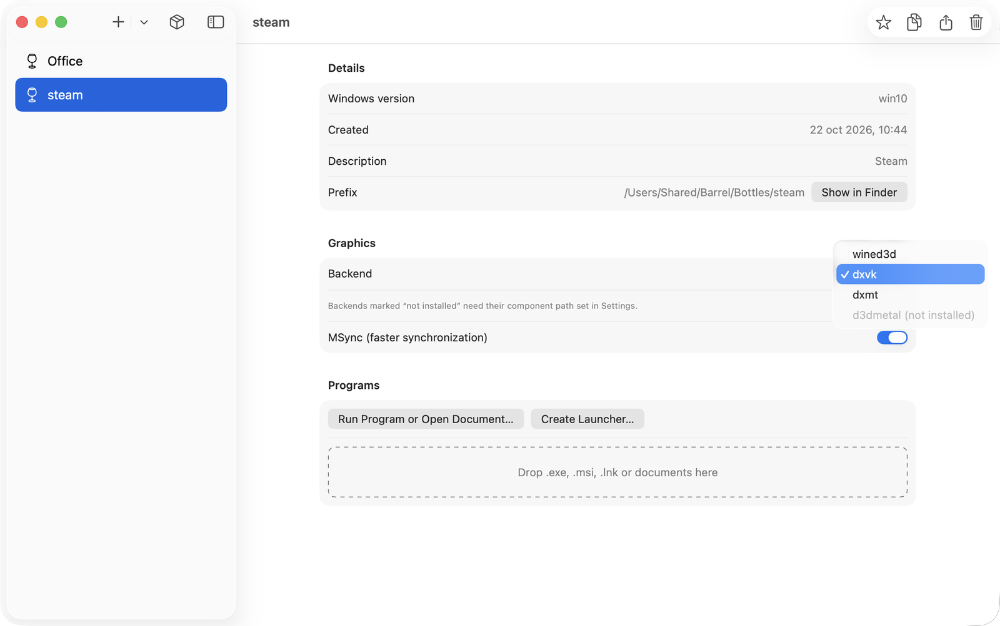

<p align="center">
  
</p>

<h1 align="center">Barrel</h1>

<p align="center">
  <b>Windows games and apps on your Apple Silicon Mac.</b><br>
  Free and open source, built on Wine, DXVK and DXMT.
</p>

<p align="center">
  <a href="https://mcgregory99.github.io/barrel/">Website</a> ·
  <a href="#what-you-can-do">Use cases</a> ·
  <a href="#how-it-works">How it works</a> ·
  <a href="#build-it">Build it</a>
</p>

<p align="center">
  
</p>

Barrel keeps each Windows program in its own **bottle**, a self-contained Windows with its
own `C:` drive and registry. It installs software from **recipes**, translates Direct3D to
Apple's Metal, and turns any program into a **Mac app** you can open from the Dock.

It comes as a SwiftUI app (`Barrel.app`) and a command-line tool (`barrel`) that do the same things.

> [!NOTE]
> Barrel is an independent project. It is not affiliated with or endorsed by CodeWeavers. It uses
> only the open-source parts of CrossOver that CodeWeavers publishes under the LGPL.

## What you can do

### Play your Steam library

One command creates a Windows 10 bottle, installs Steam silently and applies the fixes Steam
needs under Wine. A second command gives you a `Steam.app` with Steam's own icon.


### Choose the graphics engine per game

Every bottle has a Direct3D backend, and any single game can override it:

| Backend | Translates | Best for |
|---|---|---|
| `dxvk` | Direct3D 9–11 → Vulkan → Metal (MoltenVK) | most games; the default for Steam |
| `dxmt` | Direct3D 10–11 → Metal, directly | D3D11 games; less GPU memory |
| `wined3d` | Direct3D → OpenGL | old games and app UIs (Steam's own window) |
| `d3dmetal` | Direct3D 11–12 → Metal | needs your own copy of Apple's Game Porting Toolkit |


### Keep every app in its own bottle

A broken install never touches your other programs. Bottles can be copied, exported to a
`.tar.gz` and restored on another Mac.


### Or do it all from the app

| Bottle settings | Install Software | Graphics backend |
|---|---|---|
|  |  |  |

## How it works

<picture>
  <source media="(prefers-color-scheme: dark)" srcset="docs/media/how-it-works-dark.svg">
  
</picture>

1. **Wine** runs the Windows program. It implements the Windows API on top of macOS: windows, files,
   input, audio and networking. Barrel uses Wine 11 with CrossOver 26.3's open-source patches, under
   Rosetta 2.
2. **DXVK or DXMT** turn Direct3D draw calls into Vulkan (then MoltenVK) or straight into Metal.
3. **Barrel** owns everything around them: bottles, recipes, per-game settings, launchers and a
   self-contained, relocatable runtime inside `Barrel.app`.

### Performance

Stonewards main menu on an Apple M2, GPU time per frame measured with Apple's Metal HUD (lower is better):

| Engine | GPU time per frame | Metal memory |
|---|---|---|
| Barrel + DXMT | **2.64 ms** | 1.00 GB |
| Barrel + DXVK | 2.72 ms | 1.65 GB |
| CrossOver 26 + D3DMetal | 2.87 ms | — |

This is one scene in one game, not a general benchmark.

## Build it

There is no signed download yet: notarization needs an Apple Developer ID. To build from source
on an Apple Silicon Mac with Xcode and Homebrew:

```sh
brew install mingw-w64 bison cmake meson ninja glslang pkg-config
# Put the sources in upstream/ as listed in docs/wine-patches.md, then:
scripts/build-engine.sh deps && scripts/build-engine.sh moltenvk && scripts/build-engine.sh gnutls
scripts/build-engine.sh wine && scripts/build-engine.sh dxvk
scripts/build-engine.sh llvm15 && scripts/build-engine.sh dxmt
scripts/build-gstreamer.sh all
scripts/package-app.sh              # → dist/Barrel.app (ad-hoc signed)
scripts/smoke-backends.sh           # renders a D3D11 test with wined3d, DXVK and DXMT
```

| Folder | What's inside |
|---|---|
| [`barrel/`](barrel/README.md) | core library and the `barrel` CLI (Swift) |
| [`app/`](app/README.md) | the SwiftUI app |
| [`recipes/`](recipes/) | install recipes ([format](docs/recipes.md)) |
| [`patches/`](patches/README.md) | our patches to Wine and DXVK ([notes](docs/wine-patches.md)) |
| [`scripts/`](scripts/) | engine build, packaging, signing, smoke tests and these animations |

## License

Barrel is GPL-3.0-or-later ([LICENSE](LICENSE)). The bundled components keep their own licenses
(Wine, DXVK, DXMT, MoltenVK, GStreamer, FFmpeg and others): see
[THIRD_PARTY_NOTICES.md](THIRD_PARTY_NOTICES.md). The terminal animations replay real `barrel`
output; regenerate them with `scripts/render_media.py`.
