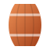
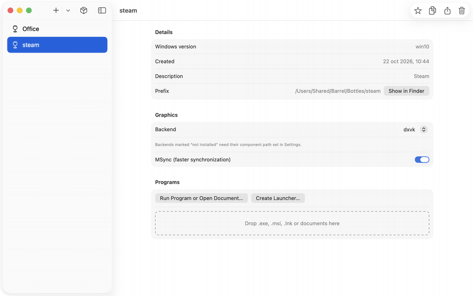
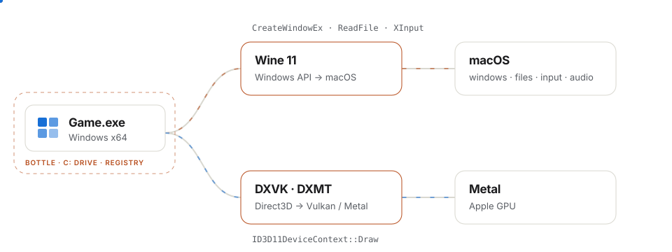
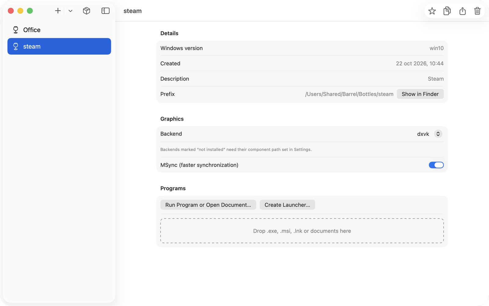
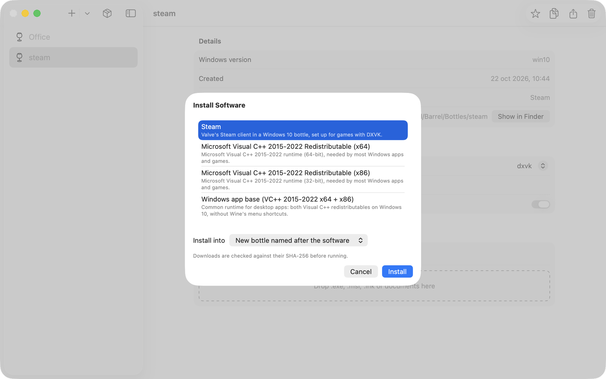

<p align="center">
  
</p>

<h1 align="center">Barrel</h1>

<p align="center">
  <b>Windows games on your Apple Silicon Mac.</b><br>
  Free and open source, built on Wine, DXVK and DXMT.
</p>

<p align="center">
  <a href="https://mcgregory99.github.io/barrel/">Website</a> ·
  <a href="#play-your-steam-games">Play</a> ·
  <a href="#how-it-works">How it works</a> ·
  <a href="#advanced">Advanced</a> ·
  <a href="#build-it">Build it</a>
</p>

<p align="center">
  
</p>

Barrel installs the Windows version of Steam, finds the games you install and plays them with the
right graphics engine for each one. Click Play in the app, or put a game in your Dock.

> [!NOTE]
> Barrel is an independent project. It is not affiliated with or endorsed by CodeWeavers or Valve. It uses
> only the open-source parts of CrossOver that CodeWeavers publishes under the LGPL.

## Play your Steam games

The first time, Barrel installs Steam into its own Windows environment and applies the fixes Steam needs
on a Mac. Sign in, install games as usual, and they show up in Barrel's library. Each game can become a
Mac app with its own icon.



Everything in the terminal is also a button in the app: **Install Steam**, **Play** and **Add to Dock**.

## The right graphics for each game

Windows games draw with Direct3D, which macOS does not have. Barrel translates it to Apple's Metal, and
each game can use a different translator:

| Engine | Translates | Best for |
|---|---|---|
| `dxvk` | Direct3D 9–11 → Vulkan → Metal (MoltenVK) | most games; Steam's default |
| `dxmt` | Direct3D 10–11 → Metal, directly | D3D11 games; less GPU memory |
| `wined3d` | Direct3D → OpenGL | old games |

**Automatic** is the default: a game uses its **profile** if it has one, otherwise Steam's default.
A profile is a small file with the settings a game was tested with
([format](docs/profiles.md)). Most games need none. Pick an engine yourself and Barrel remembers it for
that game until you go back to Automatic.



### Performance

Stonewards main menu on an Apple M2, GPU time per frame measured with Apple's Metal HUD (lower is better):

| Engine | GPU time per frame | Metal memory |
|---|---|---|
| Barrel + DXMT | **2.64 ms** | 1.00 GB |
| Barrel + DXVK | 2.72 ms | 1.65 GB |
| CrossOver 26 + D3DMetal | 2.87 ms | — |

This is one scene in one game, not a general benchmark.

## How it works

<picture>
  <source media="(prefers-color-scheme: dark)" srcset="docs/media/how-it-works-dark.svg">
  
</picture>

1. **Wine** runs the Windows program. It implements the Windows API on top of macOS: windows, files,
   input, audio and networking. Barrel uses Wine 11 with CrossOver 26.3's open-source patches, under
   Rosetta 2.
2. **DXVK or DXMT** turn Direct3D draw calls into Vulkan (then MoltenVK) or straight into Metal.
3. **Barrel** owns everything around them: Steam's setup, the library, game profiles, launchers and a
   self-contained runtime inside `Barrel.app`.

## Advanced

Want to go deeper? Under the hood, Steam lives in a **bottle**: a self-contained Windows with its own
`C:` drive and registry. You can make more of them, for any Windows program, not just games.



| | |
|---|---|
| **Bottles** | Create, copy, export to a `.tar.gz` and restore them. Each has its own Windows version, graphics engine and settings. |
| **Recipes** | One-click installers written as small JSON files ([format](docs/recipes.md)). Steam is one; write your own. |
| **Command line** | Everything the app does is a `barrel` command ([reference](barrel/README.md)), for scripts and power users. |
| **Game profiles** | Got a game working? Record what it needs. [`skills/barrel-game-profile`](skills/barrel-game-profile/SKILL.md) walks you (or an AI agent like Claude Code) through testing it properly. |

| Bottle settings | Install Software |
|---|---|
|  |  |

## Build it

There is no signed download yet: notarization needs an Apple Developer ID. To build from source
on an Apple Silicon Mac with Xcode and Homebrew:

```sh
brew install mingw-w64 bison cmake meson ninja glslang pkg-config
# Put the sources in upstream/ as listed in docs/wine-patches.md, then:
scripts/build-engine.sh deps && scripts/build-engine.sh moltenvk && scripts/build-engine.sh gnutls
scripts/build-engine.sh wine && scripts/build-engine.sh dxvk
scripts/build-engine.sh llvm15 && scripts/build-engine.sh dxmt
scripts/build-gstreamer.sh all
scripts/package-app.sh              # → dist/Barrel.app (ad-hoc signed)
scripts/smoke-backends.sh           # renders a D3D11 test with wined3d, DXVK and DXMT
```

| Folder | What's inside |
|---|---|
| [`barrel/`](barrel/README.md) | core library and the `barrel` CLI (Swift) |
| [`app/`](app/README.md) | the SwiftUI app |
| [`profiles/`](profiles/) | tested game profiles ([format](docs/profiles.md)) |
| [`recipes/`](recipes/) | install recipes ([format](docs/recipes.md)) |
| [`skills/`](skills/) | instructions for AI agents working on Barrel |
| [`patches/`](patches/README.md) | our patches to Wine and DXVK ([notes](docs/wine-patches.md)) |
| [`scripts/`](scripts/) | engine build, packaging, signing, smoke tests and these animations |

## License

Barrel is GPL-3.0-or-later ([LICENSE](LICENSE)). The bundled components keep their own licenses
(Wine, DXVK, DXMT, MoltenVK, GStreamer, FFmpeg and others): see
[THIRD_PARTY_NOTICES.md](THIRD_PARTY_NOTICES.md). The terminal animations replay real `barrel`
output; regenerate them with `scripts/render_media.py`.
